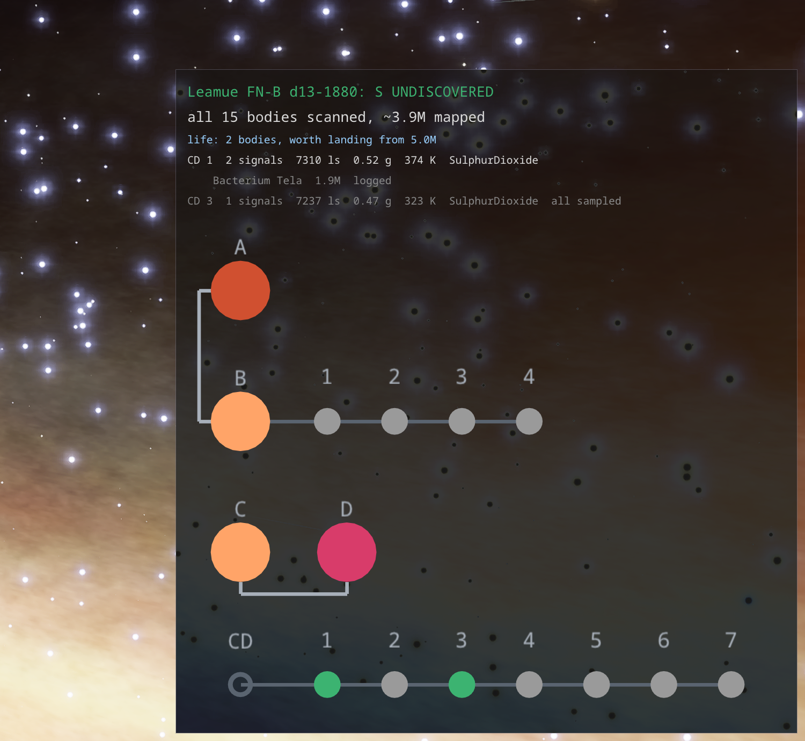

# Exploration and exobiology

The *atmospheres*, *to map* and *life* blocks below, and the green ring round a planet's face on the system map, show
only while the Exploration window is the current one in the tool and not minimized - the game may have the
focus meanwhile. Choosing System info, Construction or any other window takes them off the overlay.

The bottom right corner of the overlay follows the order of work in a new system:

1. **arrival** — whether the arrival star was discovered before ("discovered before - jump on") or is
   `UNDISCOVERED`, the star's radius in km and in light seconds, and how many bodies from the honk
   have been scanned already. The game writes neither where its exclusion zone ends nor how far the
   ship is from the star - that is only on the HUD - so the radius is the scale to read the HUD's
   distance against, which matters at a white dwarf or a neutron star, a few thousand km across.
   At a white dwarf a line says how far to keep: the game gives no warning before the drop, and the
   heat comes too late to be one. The figure is the HUD distance at which the danger began at one DC
   dwarf, 78 of its radii (`exploration.white_dwarf_danger_radii`), scaled by this dwarf's radius,
   with the number of measurements it rests on (`exploration.white_dwarf_measurements`),
   Under it, when the FSS reported **notable stellar phenomena** (a Lagrange cloud, sometimes with
   space life in it), a line says so - in inhabited space too, where mining sites and installations
   bury it in the game's own lists. The journal gives neither how many there are nor where, only
   that the system has them (`FSSSignalDiscovered` with `SignalType` `Codex`); the FSS shows them, then
   the nav panel. Once a codex find is made in space in that system (`CodexEntry` under Biology
   without a latitude - geology on the ground has one), the line turns to "visited" with what was
   logged. The Exploration window lists the systems where phenomena were reported and never visited,
2. **atmospheres** — the atmospheres of the landable planets of the system whose atmosphere a scan told,
   the rarest first: `atmospheres:  Water (5)  Argon (255)  CarbonDioxide x2 (456)`. In brackets, how many
   landable planets with that atmosphere the galaxy database knows (with `exploration.shared_galaxies`, the
   other accounts' too, a planet in two of them once; the same count as the *Atmospheres* tab), these among
   them; `x2` when more than one of them is here. One known 10 times or fewer is green, a rare one worth the
   landing to see. The counts are read again in another system, when a planet's atmosphere becomes known, and
   every 5 minutes. Under it, a line for each planet (at most 4) whose surface lies outside the other known
   landable planets of its type, itself left out: `colder`/`warmer` (K), `thinner`/`denser` (Pa),
   `lighter`/`heavier` (g), each with the range known; `volcanic (N known)` while at most 3 others of its type are
   volcanic; `few known (N)` instead when fewer than 5 others are known. Such a planet is a candidate for a colour
   of its air that edworld does not know yet: a second one came with volcanism on Neon worlds, and one Ammonia
   moon has another for no reason its scan shows - which this cannot catch.
3. **to map** — bodies worth the probes, most valuable first, green when it is a first discovery,
4. **life** — bodies with biological signals left to sample, in the order of a route through them from
   the body the commander is at or was at last in the system (the arrival star before any), the bodies
   placed where their orbits have them now: nearest neighbour, then 2-opt, as for the route of the System
   window. The `ls` of a body is how far it lies from that body, and the order is worked out again when
   the commander comes to another body or a body leaves the list (a body whose every genus is sampled
   leaves it). The list is as long as the band has room for, down to the system's diagram, which
   gives way to it down to a quarter of the screen's height (`diagram_min_share`, 0.25); a body
   goes with all its genera or not at all, and what does not fit is told as `... and N more`.
   `bio_bodies` (0) caps the number of bodies when it is not 0. For each genus, one to a line, the species it
   most likely is on this world with their shares and prices (`candidates`, 3); green when it is worth
   landing for (`bio_worth`, 5M).

Before the probes map a body, its genera are guessed too: the line of the body says `guessed from N
alike`, and under it come as many genera as the scanner counted signals, each with the share of the
alike worlds mapped before that had it (`Bacterium 96% ? Vesicula 1.0M 58% | ...`). A world counts as
alike when it has the same atmosphere, a temperature within 10 K (`alike_kelvin`) and a gravity within
a fifth (`alike_gravity`); the worlds are those both accounts mapped, sampled or not. On 325 mapped
worlds, guessing each from the rest, 87 of 100 genera were right, and a genus said at 90% was there 93
times in 100, at 50% 65 times. A genus under 50% does not make the body green. With no alike world,
the genera come from the nearest worlds under the same atmosphere (`alike_far_worlds`, 5), counting each
window of temperature and gravity as one, while the nearest is within four windows (`alike_far`): the body
line then says `~ from N further` and the shares have a `~` in front (`Bacterium ~80%`); such a guess never
makes the body green. Guessed so, 89 of 100 genera were right where the nearest was within four windows,
43 of 100 beyond them. With nothing near enough the line stays `map it to learn the genera`.

The species is guessed from your own history. Every species sampled is stored together with its
world (planet class, atmosphere, temperature, gravity, the star above it), and a genus on a new world
is compared with what has already been found under the same atmosphere. On 374 species from the
archive, guessing each one from the rest, the first answer is right in 302 cases and one of the first
two in 349. The more samples, the narrower the guess.

Beside the guess stands what one scan would teach, in its own colour whatever the species pays: the
history of both accounts is asked what it knows of the genus on a world like this one. `new: genus`,
`new: atmosphere`, `new: 12 K warmer` (colder, heavier, lighter: past every find under this
atmosphere), `new: F star` (never under this kind of star - the variant may be a new one), or
`few like it (2)` (fewer than `exploration.little_known`, 3, finds within 5 K and a tenth of the
gravity). A genus seen often on such worlds gets no note, and a cheap one stays grey: nothing is left
to learn from it. A body with such a genus is listed in the same colour (`exploration.new_knowledge`).
The first scan is enough: it names the species and puts the world into the history.

On the surface, in the place of the target panel left of centre, the sample in progress is shown:
species, price, 1/3–3/3 and the distance from the nearest earlier sample against the colony range,
counted live from `Status.json` — a green "sample" when you may take the next one. Below it, what else
grows on this body. It shows in analysis mode or with the sampler in hand, in an SRV always - not in combat mode nor on foot
with a weapon.

**The System window** lists the bodies of the current system by name, each moon under its planet. The flag columns have short headers,
each explained when the pointer rests on it. Your own deeds sit in *M* (mapped) and *FF* (footfall: you
stepped onto the body - from the ship, an SRV or a taxi), *T* marks a terraformable body, the game's word on other
commanders is in *wD*, *wM* and *wF* (was discovered, was mapped, was footfalled), the last three in their own colour
(`gui.mapped_before_column`). A body you cannot land on has no *FF* or *wF* box. A body worth more than 300k if mapped is in `gui.value_medium`, more
than 600k in `gui.value_high`.

Tick the bodies you mean to visit in column *V* and press **Calculate route** below the table: each is numbered
in the order to fly, and the legs are listed beside the button in light seconds. The route starts at the body
`Status.json` names, otherwise at the star the jump arrived at, and takes the bodies where their orbits have them
now; a pair of planets or moons sharing a barycentre stands by the star or planet they circle together. A
changed tick clears the route; the ticks last until you leave the system.

Navigating on foot to a codex entry or a place tipped off by a guide is its own window, in
[surface_navigation.md](surface_navigation.md).

**What cartography really pays.** The *Cartography* tab of the Exploration window lists every sale of
cartographic data in the journals: when, which systems, the bodies sold and those EHT could price,
EHT's estimate at the moment of the sale (the same reckoning as the cartography a death would cost),
and what the game paid - base, bonus and the sum that reached the account. The game writes one sum for
all the systems of a sale and nothing for a body, so only a sale of one system is an exact price;
over those the tab gives the base over the estimate (median, lowest, highest). The base is what the
bodies were worth, the first discovery included; the bonus is paid on top for a system scanned or
mapped in full, and a fleet carrier keeps a quarter of the base. Sell system by system to learn more:
the overlay reminds of it while the station services are open at a place with Universal Cartographics
(the `exploration` service of the `Docked` event) and cartography is unsold.
Exobiology needs no such check: the price list agrees to the credit with every sample sold in the
archive, and the first-logged bonus is always four times the price.
`journal_tailer --cartography --dir <journals> --commander <FID>` prints the same.

**The stars visited.** The *Stars* tab of the Exploration window counts the stars of the systems visited (a
system with a star in the database: only a visit scans one) in two tables, the galactic region the commander is in
and all of them: each kind of star, what it is, how many systems it is the arrival star of - the one the jump drops
the ship at, and what share of the systems that is - and how many stars of it there are in all, a system of several
stars counting each. Grouped as the galaxy map's star filter (map mode *Star class*: O to Y, proto stars - T Tauri
and Herbig Ae/Be -, carbon, Wolf-Rayet, white dwarf and non sequence stars - neutron stars and black holes -, a giant
under its letter), each row one of the filter's switches, or by type (`G`), by type and subclass (`G9`) or by type
and luminosity class (`G Vab`), it shows which kinds are still rare, to visit the kinds evenly and switch the map's
filter to them for the next jumps; the filter only hides stars on the map, the route planner does not follow it. The letter is the temperature
class, O the hottest to M the coolest and L, T, Y the brown dwarfs; the digit splits it from 0, the hottest, to 9;
the luminosity class is the star's size - V the main sequence, its Va, Vab and Vb the brighter, middle and fainter
part of it, Vz a star just come onto it, IV subgiants, III giants, VI subdwarfs and VII white dwarfs.

**Where to jump for a rare atmosphere.** The *Atmospheres* tab of the Exploration window tells, for each atmosphere
of a landable planet, the chance of a jump to find one, by the class of the arrival star - the one the galaxy map shows
and its star filter switches, grouped as on the *Stars* tab. The chance is the share of the systems scanned in full
with one such planet at least; a system is in full when as many stars and planets are known as its discovery scan
counted, so a system left half scanned does not lower it. The list of atmospheres starts with the rarest, each with the
planets found and its chance over all those systems; the table gives each class's systems in full, those with the
atmosphere, its chance and how many times the average that is. A class with fewer than 20 systems in full is grey, its
chance weak. Two tables more tell where such planets sit, over every system: the class of their parent star, and
whether they go around a star or are moons of a gas giant, an icy body or a rocky or metal one, each with its share
beside the share of all landable planets with an atmosphere; these explain, but cannot be seen before a jump. It reads
this account's galaxy and the ones of `exploration.shared_galaxies`, while shown, again when a body is scanned or five
minutes on.

**What the galaxy map shows, by mass code.** With `edworld_eht.dll` in the game, while the galaxy map is open and the
Exploration window is the current one, the top right block shows the systems the map labels now (edworld reads the
labels off the map's text, `galmap` in its `shm_dir`) in place of the territory: a heading with how many and the sector
most of them lie in, then a line for each mass code among them (the letter in `Sector AB-C d12-34`: how heavy the
heaviest star may be) - how many in view and how many never visited, and of that code's systems scanned in full
(the same full scan as above) the share with a landable planet with an atmosphere and with a rare one (known on at most
`exploration.rare_atmosphere_worlds`, 20, landable planets), its most common arrival stars; the code with the highest
share of rare ones first, green, and `~N` after a share from fewer than 20 systems in full. Under each code its
systems in view without the sector, four a line and three lines at most: the never visited first, in the plain
colour, the visited grey. A label with a glyph edworld does not know yet, a
name of its own (Colonia) and the grid's coordinates are left out. The shares come from this account's galaxy and
`exploration.shared_galaxies`, read again every five minutes. `exploration.galaxy_map_predictions = false` keeps the
territory there. The *Galaxy map* tab of the Exploration window shows the same in a tree - each code a branch with its
shares, its systems under it, the never visited first and the visited grey, by name without the sector - and keeps
the last list when the map is closed (with the time it was read); a double click on a system, or *Copy name*, puts
its full name on the clipboard for the map's search: a visited one as the database writes it, a new one with its
sector as the database writes it and the mass code in lower case (`Bleia Eohn PW-D b32-6`). It looks at the file
every second while shown. The codes tell apart little - in 5347 systems (2026-11-16) a rare atmosphere came in 0.8% (b) to 4.7%
(c) of them - so its use is mostly what was never visited.

**How a body is priced.** The formula in common use among explorers, corrected where the sales
disagree with it:

- a planet: `k + k * 0.56591828 * mass^0.2`, where `k` is the value of its class (with the
  terraformable bonus), times the mapping multiplier when mapped - 3.3333, or 3.6996 for the first
  discoverer who also maps it, or 8.0929 for the first to map a body someone else discovered,
- at least 500, then a third more and never less than 500 more (a small icy body is worth 1000),
- times 1.25 when mapped with no more probes than the target, times 2.6 for the first discovery,
- a star: `k + mass * k / 66.25` (1200 for an ordinary star, 14057 for a white dwarf, 22628 for a
  neutron star or a black hole), times 2.6 for the first discovery, and a third more for every star
  but the one the jump arrives at.

Over the single system sales of a station (not a carrier) from systems scanned in full, 69 of 83 agree
within a tenth of a percent. The rest are systems sold more than once, where the journal cannot tell
what was already paid for.
A system not scanned in full sells for more than its scanned bodies: the game pays for every planet
you did not scan as well, a quarter of its value - see
[The bodies you never scanned are paid for too](unscanned_bodies.md).

## Codex

With every sample the layer takes a picture of the centre of the screen (see
[overlay/README.md](../overlay/README.md)), and
the tool puts it in `codex/pictures/` next to itself, described in `codex/pictures.json`.
`codex/index.html` is written from the database at start and after every sample: family by family,
species by species — price, number of finds, temperature and gravity range, atmospheres, worlds and
stars, pictures, a table of systems and bodies, and what of the family has not been found yet. The
*Codex* button opens it. The pictures live in the directory, not in the database: the database can be
rebuilt from the journals, the pictures cannot.

What the pictures show can be, though. Every picture is named after the journal's timestamp of the
moment it was taken for (the sample, the jump, the scanner), so `pictures.json` and `sky/sky.json` are
a convenience, not the only record: at start, a picture missing from its list - the list lost, broken,
or the picture copied back from a backup - is described again out of the journals, and a list that
cannot be read is kept aside as `.broken`. Only the place of a sample on the ground is lost that way,
since it comes from `Status.json` and no journal has it. Backing up means copying the `codex/`
directory and the journals.

Settings are in the `exploration` section of `eht_settings.json`: `bio_worth`, `bio_bodies`, `diagram_min_share`,
`candidates`, `alike_kelvin`, `alike_gravity`, `alike_far`, `alike_far_worlds`, `capture`, `capture_size`, `codex_dir`, `jpeg_quality`, `codex_name`, `shared_codex`.

Two accounts of your own can show one codex and one sky album: see
[sharing between accounts](elite_without_steam.md#sharing-between-accounts).

## Sky album

Out of a jump the ship faces the arrival star, and after the surface scanner closes it still faces the
planet it mapped. At those two moments the layer quietly takes a picture of 80% of the middle screen in
its own 16:9 shape (`exploration.sky_size`), with no frame and no countdown: the star after the jump, in
unpopulated space, tried at 1 s, 2 s and 3 s in turn (`sky_star_delays_ms`: at 0 s the tunnel is still on
the screen; the series stops at whichever attempt first finds the ship's own view, so a map or a scanner
opened during one attempt only costs that attempt, not the ones still to come), and the
planet as it stood before the scanner: in analysis mode, with a planet of this system set as the
destination, the view is taken every 2 s and kept aside; the scanner opening holds the last one, and
the mapping puts it into the album. Without such a view the planet is taken 1.5 s after the scanner
closes (`sky_planet_delay_ms`). The star's scan comes some seconds after the
jump, so the first pictures are described once it is in. Each body is taken once, and only from the ship's own view in supercruise -
a menu or the galaxy map open at the moment an attempt falls due drops that attempt alone. They go to
`codex/sky/<system>/`, named after the journal's moment of the jump or the scanner, are described in
`codex/sky/sky.json`, and shown on the page of their system; `sky_pictures` turns them off.

The album itself is a book of the systems known, made out of the database, so a system visited long ago has
its page like any other. `codex/sky.html`, which the *Sky* button opens, is the index: the galactic regions, in
them the sectors folded, in them the systems, each after a dot in the colour of the star the jump arrives at (the
colours of the game's system map; its type in the tooltip), with a mark for a picture, for life and for a first discovery
and the count of its
bodies by kind - `[S:1, G:3, H:1, I:1, R:14]` is one star, three giants of any class, a high metal content world,
an icy one and fourteen rocky ones; E is earthlike, W a water world, A an ammonia world, M metal rich, Ri rocky ice.
The journal names a region only in a codex entry; the album takes every system's region from the region map of
[EliteDangerousRegionMap](https://github.com/klightspeed/EliteDangerousRegionMap) (MIT), by the boxel the system's
address names - on 195 systems with codex entries it gave the game's own region every time. A system outside the
map stands under *Unknown region*.

`codex/systems/<system>.html` has the picture of the system as on the overlay, its bodies linking to their cards,
the pictures from the ship, and a card for each body, six in a row: its class, gravity, temperature, atmosphere and
what it is made of, volcanism, orbit, rotation, axial tilt, rings, geological and human signals and value, whether it
was a first discovery, unmapped or without a footfall before the scan, the species found on it and the pictures of
the samples. In the codex the name of a
system leads to its page. The pages are made in the background at a low priority, at start and every five minutes;
each remembers in its first line what it was made from, so only what changed is written again. Two accounts each
make pages for the systems of their own database, showing the pictures and finds of both; a system only the other
account knows is listed with a link to its page there, once that account has run.

## Faces of the planets

The balls of the overlay's system map get the faces of the bodies the surface scanner has been on,
dug out of pictures already kept. The scanner shows a body as a ball lit evenly all over, close to its
bare colours, and its views are kept under `codex/scanner/<body>/`. The body is the one set as the destination, which the scanner needs targeted - the journal names it
only when the mapping ends. A view is kept only once the scanner has
stayed open a second after it (`scanner_hold_ms`): closing, the game fades the view out before the status
file says it is closed, and a darkened view would make a black face. In each the ball is found - every
strong edge votes for the centres its gradient points at, the best centre takes the radius most of its
edges stand at - and a view is used only when the ball lies whole in it with most of its rim showing,
and no probe streaks across it. Of those the one least painted cyan wins: a filter paints the regions
of its genus cyan, a view without a filter has hardly any. Its ball is cut out to 128 px, and the
scanner's own marks on it - the white dot, the needle, the thin cyan rings - are filled from around
them. When every view is painted by a filter, only the relief is kept and the colour comes from the
lit side of the body in its sky album photo, or from its class when there is no photo.

On the ground the views come back as thumbnails at the bottom of the left band, under "scanner views of
<body>" (`scanner_pictures`, on by default; not while the scanner itself is open): its filters showed from
orbit where each genus grows. Up to `scanner_views` (6) views of a body are kept, each a thumbnail of
`scanner_thumbnail` (400) pixels. They keep within a box of `scanner_box_width` (0.5) of the band's width and
`scanner_box_height` (0.5) of the screen's height - the lower left quarter of the band - and in it the
overlay takes the number of columns, up to `scanner_columns` (3), that makes them largest: six views stand in
two columns of three. A box of 0 lets them take the band's width in `scanner_columns`.

The way to a body gives faces too, and in the body's true colours. With a planet of this system set as
the destination and the ship's own view in supercruise, the layer is asked for a small sample of the
middle of the screen four times a second: shrunk on the graphics card by halving it again and again,
each step the mean of 2 x 2 pixels, to a few hundred pixels across, and written into a file both
sides share (`captures/<socket>_sample.bin` beside the socket). The game waits for none of it - a few
microseconds a frame. Each sample is judged in a thread: the ball must be found whole in it - its
night side's rim may be lost against the black, and the edges in the HUD's cyan and orange do not
count, or the target's ring round its middle would be taken for a small ball - and the cockpit's frame must hide next to none of it.
It must stand out of the sky just beyond its rim - darker, lighter or of another colour along at least a
quarter of it: far off the planet is a dot, and the stars and dust behind it can outline a circle that
passes for a ball, with the same sky on both sides of it. A moon before the bright face of its gas giant
stands out as well as a planet against the black. A circle the view cuts off is passed over for the next
one, so the arc of the cockpit's frame at the side does not hide a whole ball in the middle.
Only the part of the sample above 70% of the screen's height is judged: below it lies the dashboard,
where the target panel's hologram is a lit, textured ball too and would be taken for the planet.
It must also be large enough on the screen, 110 px of radius (`exploration.approach_radius_px`): the
size a planet has 1 Ls away, so a larger planet is taken from farther and a smaller one from nearer, in
proportion to its radius - farther off, the game draws a ball without the face it shows up close.
Larger than that is no better; the more of it in daylight the better, and the ship's orange HUD over it
counts against it. Only a sample better than the best face
kept asks for a real picture, and only of the rectangle the ball stands in, at most one every 2 s
(`exploration.approach_faces`, `approach_interval_ms`). The picture is judged again at its own size and
kept when it is at least as good. Its light is taken off before it is kept: the direction of the light
is fitted to the brightness over the ball, each pixel is divided by how squarely it faced the light,
and the night side is filled from the day side mirrored across the terminator. The target's ring, its
dot and the words written beside it are filled from around them like the scanner's marks. It is kept
in `live.sqlite` (table `approach_view`), the pixels packed with zstd and the score in the same row,
so the two are written together or not at all and travel with the backup's copy of `live.sqlite`: of
all a face is made from, this view is the one nothing can give back. Views an older build kept under
`codex/approach/` are taken in the first time their body is shown; the files stay. A scanner view in the body's own colours still
comes first; the cockpit's face comes before a scanner view painted by a filter.

The face is made in a thread of its own the first time the map shows the body, and made again when a
newer view comes in; it is written to `codex/faces/<body>.png` to be looked at - it is made again at
every start, never read back - and handed to the overlay beside the
socket. A body with life, whose flat ball is green, keeps its face and gets a green ring instead, shown
while the Exploration window is the current one.
