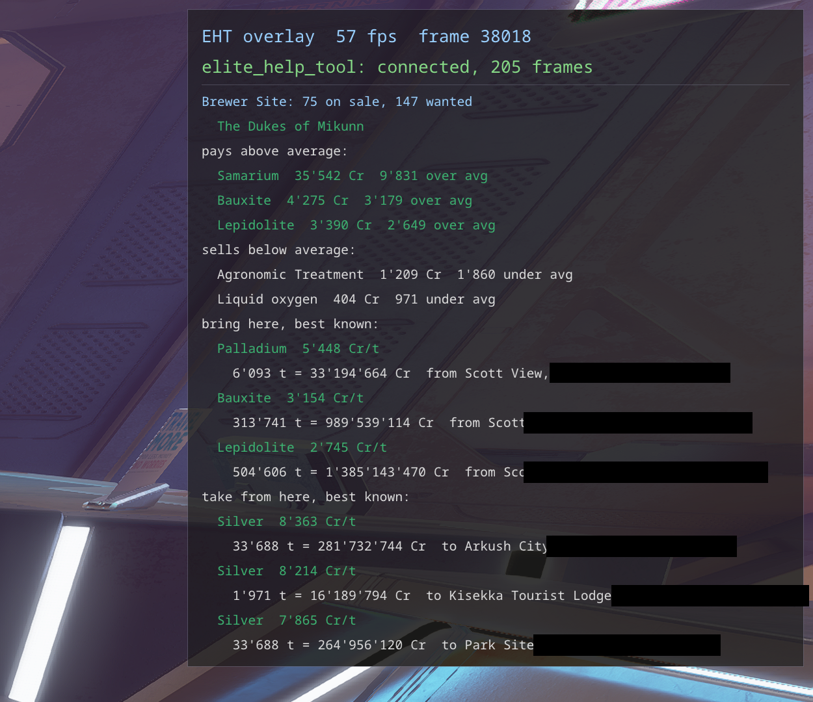

# Trade

- **The station's market on the overlay**: what it pays above and sells below the galactic
  average, beyond 25% and 500 Cr/t, with minerals that pay well only from mining listed apart. A
  market never opened says so in the side band - easy to miss - and, for a ship actually docked
  there (not a taxi ride, not an on-foot arrival), a second, wide reminder across the top middle of
  the screen in the ordinary overlay size: *open the Commodities Market to record it*
  (`overlay.market_reminder`, its own place and width, on by default). A colonisation building site,
  in space or on the ground, has no market to open, so neither is shown there.
- **"controlling faction changed since last reading - reopen the market"** (`market_stale` colour):
  the market has a reading, but the station's controlling faction has since changed and the market
  itself was never reopened. The game gives no notice when this happens, and what is legal to trade
  can depend on who runs the place, so the old reading may no longer be trustworthy.
- **Best known trades**: what to bring here and what to take from here, against every market you
  have ever opened. Each line gives the margin per tonne, the tonnes (capped by your hold, the stock
  and the demand), the profit of the run and the station. With a route plotted, it looks for what to
  take to its end and what to bring back.
- **Fleet carrier bars**: the bartender's shelf of every carrier visited, with prices and sold-out
  items, filterable to your own carriers. Where each material came from is tracked too, collected
  or from missions, over 30 days, 90 days or all time.
- **Bartender**: what you sold to bartenders, bought and bartered, item by item and summed by
  category (goods, assets, data), with the credits of sales and purchases. The game's own
  `Statistics` already count Horizons material traders, so they are not repeated here.
- **Bar sales** of your own carrier: the game never says a player bought from your bar, but the
  shelf does. Read the bartender on arriving, before adding anything, and again after: a fall in
  stock between readings is a sale at the price shown before it, a rise is what you added. Per
  item: units sold, revenue, in how many absences it sold at all out of those it lay on the
  shelf, and the price against a port's bartender. The port price comes from a built-in list of
  what a port's bartender pays, the same at every port (186 kinds, from the item pages of the Elite
  Dangerous wiki, checked against real sales at ports, every one of which adds up to the credit). The few rare kinds the
  list lacks are worked out from your own sales at ports - a sale of one kind gives its price, a
  sale where all kinds but one are known gives that one. A reading with no stock and no price
  anywhere, written before the bar has loaded, is skipped; a shelf sold out keeps its prices and
  counts as sold. Data, goods and assets
  are listed apart, each with its sums over the heading.
- **Mission value**: which kinds of mission pay best at your carrier's bar - what their material
  rewards fetch there, per mission and in all. The missions' credits are not counted.
  *Sold* is what the rewards have brought: each piece at what one piece put on the shelf has brought
  so far, the revenue of its kind over all the pieces put up (the first reading's stock and every
  rise since). *At the bar* is an estimate instead: the price on the bar times the share of absences
  the kind sold in there, so a price nobody pays counts for little. A kind never put on the bar takes a port's
  price when known and is otherwise counted as unvalued. Mission versions (`_004`, `_007`) are
  counted as one kind. Data and goods are listed apart; assets are left out, as they sell for next
  to nothing. The average is over all the missions of a kind, those that gave nothing of the
  category too.

These are the tabs of the Asset trade window. It reads its tables only while it is shown, and at most
once a second as items are picked up; a hidden window is read when it is shown again.

- **Holdings**, in the Assets window: every kind of data, goods and assets you hold, in three tables,
  with how many are in the backpack, in the ship's locker, in the store of each of our carriers (your own
  fleet carrier and the squadron's carrier) and the total - to see at the mission board
  whether a reward is one you lack or one you have plenty of. The backpack and the locker are the
  game's own lists; a mission's thing to deliver is left out, and so are consumables. The game writes
  what is picked up or taken out of the locker on foot at once; what is moved while aboard it carries out
  only on leaving the ship, and on boarding the backpack goes into the locker without a word for the
  backpack - so the backpack counts as emptied of them then. A carrier's store is in no journal, so it is
  kept from the locker: on docking at one of our carriers the backpack and the locker are noted
  together, and at every change of the locker while docked - and again on leaving - what they have less
  of was left in the store, what they have more of was taken from it - handed in at your own bar
  included. So the store changes at once as you put things in or take them out. Started while docked,
  or the game started docked, the tool counts from what is held then; what was moved while it was not
  running is not known. The bar of your own fleet carrier sells out of its
  store, so a reading of its bartender - yours in the game, or another commander's heard through EDDN -
  is the store's count of every kind on sale, a sold out one at 0; a kind not on sale keeps the count of
  the visits. A reading during a visit books what was moved so far and measures afresh from it, so what
  is added between two readings counts once; one heard from EDDN that is older than the store's last
  change is not applied. Double-click a carrier's count to correct it; a kind held nowhere yet - many lie in a
  carrier's store only - is set with the row under the tables (carrier, kind, count, *Set*), whose list
  has only the kinds not in the tables; it then shows in the table of its kind. Tick *Junk* on a kind to mark it as junk; with *No junk* (on at every start)
  marked kinds are hidden in all three tables - clear it to see them again and take the mark off. The
  mark is kept in the micro resource dictionary in `live.sqlite`, the same for both commanders. It is kept in `live.sqlite` and counts only while EHT runs.
- **Bartender stock** (the first tab of Asset trade): the bartender's shelf of every carrier as last
  read, what is for sale and at what price - read it before and after adding to see what sold. The
  bartender of your own fleet carrier keeps nothing of its own: it lists kinds out of the carrier's store,
  and which kinds and at what price is yours to choose. So for your own carrier the tab shows the kinds on
  sale and their prices from the last reading, and the count from the store, as in Holdings; a kind in the
  store that is not on sale is only in Holdings. A reading newer than the store's last change sets the
  store's count of the kinds on sale - also one taken before the store was counted, at the next start. With
  `eddn.listen` on, the shelf of your own fleet carrier is read for you too whenever another commander
  opens its bar with a tool that sends to EDDN (see [privacy.md](privacy.md)); such a reading shows
  the shelf before their purchase, and the next one shows what they bought.

The **Trade** window (its button on the left bar) holds three tabs:

- **Market Info**: the whole market of one place, what it sells and what it buys against the galactic
  average, with the time of the reading - *(EDDN)* after it when the reading was heard on the relay. Type a
  system and pick it from the list (the systems with a market read, own or heard on EDDN), then a place of it
  from the list beside, each with its type and the age of its reading. *Here* picks the system you are in,
  and the port last docked at when it is in that system; the first time the tab is opened by hand it starts
  there. A station clicked in the System info window's list, or double-clicked in Search or To update, shows
  here too. *Station buys* lists only what the station consumes. What it produces it takes back too, at a
  loss, which corrects a purchase made too large and is no market for it: the *Sell back* column of
  *Station sells* gives that price.
  A trade made with the tool running is taken off the reading kept, as the game writes `Market.json` only
  when the market is opened: a sale (`MarketSell`) off the demand, a purchase (`MarketBuy`) off the stock,
  never below nothing, until the next reading replaces it. A trade older than the reading, one made while the
  tool was not running, or of a commodity not yet in the dictionary changes nothing.
- **To update**: the places in the systems our commanders claimed and still hold whose market is
  worth reading - *never read*, or *owner changed since* when someone else took the place after the
  reading, as after a war (from the owner kept with the reading, or from the history of owners), with
  how many of each system's places are to update. A market heard on EDDN counts as read and says
  *EDDN* after its date; a place known only from the relay is listed too. The systems go by their light years from the one you are in,
  the nearest first, and the places of a system by their Ls; a heading sorts by itself instead. Its type, largest pad, Ls and the date of the
  reading go with each; building sites, carriers and places of unknown kind are left out. The kinds
  of place can be left out as in Search, and *Only to update* (on at the start) hides the markets
  read since the present owner took over. A place seen in no journal is not known to the tool.
  Double-click a place to see its market.
- **Search**: where a handful of commodities can be bought, or sold,
  among every market you have opened, and those heard on EDDN's relay around your systems. Type a commodity and pick it from the list - up to nine, each
  with the tonnes wanted (0 for any stock at all) - or take what the open missions still need with
  *From my missions*. A market counts for a commodity when it sells it with at least the tonnes wanted
  in stock. The places with the most of them come first, then the nearest; a click on a heading sorts
  by it instead: hits, place, type, largest pad, light years and jumps from where you are, Ls from the
  arrival star, the cost of all the wanted tonnes (only where every one is there; 0 t counts as one
  tonne, so with no amounts it is the price of a tonne of each), the balance against a *Mission reward*
  typed in from the mission board (only with every amount given), and the age of the reading. *Order by
  Price* puts, among the places with as many of them, the cheapest first - the dearest when selling - by
  the same sum, then the nearest. Under each place, shown open, a line per commodity gives its price, its stock and how far the price is
  from the galactic average, or says it is not sold there or too little is. When no single place has
  them all, up to three pairs of places that together do are shown above, the shortest way first: to
  the nearer one and on to the other. The list of what is wanted, the filters, the pairs and the places
  share the height by handles between them, kept with the window. Double-click a place to see its whole market in Market Info. Jumps are the
  distance over the jump range the game gives for the ship flown (`MaxJumpRange` of `Loadout`), rounded up -
  a floor, a real route may need more.
  With *Stations buying* (off at the start) it finds where to sell them instead: a market counts for a
  commodity when it consumes it and wants at least the tonnes to sell; a station taking back what it
  produces does not count. The price is what it pays, the amount how much it wants, and *Earns* the sum for
  all the tonnes. *Mission reward* is off in this mode; the pairs stay, for a load too large for one buyer.
  The filters keep space stations, outposts, ports on the ground, settlements and fleet carriers
  (off at the start - a carrier moves away, and its market with it), the largest pad at least S, M or
  L, places whose pads are not known, markets heard on EDDN (*EDDN prices*; the *Source* column says
  *own* or *EDDN*), and readings no older than so many days
  (`windows.buy_max_age_d`, 30 by default, the starting value of the field), and places at most so many
  light years from the system you are in (`windows.buy_max_ly`, 100 by default, the starting value of
  the field; 0 for no limit) - a place whose distance is not known is left out while the limit is on. The pads come from
  docking: a place docked at has them as soon as the tool reads that Docked. Places docked at before the
  pads were kept were found by reading every journal once; after that a start reads only the journals newer than
  the last one read. A place never docked at keeps them unknown.

  **Markets from EDDN.** With `eddn.listen` on and `eddn.market_radius_ly` above 0 (0 by default), the
  markets other commanders' tools send to EDDN are kept when their system lies within that many light
  years of a system the commanders of this journal directory claimed and still hold, or of the one the
  commander is in - the system's position from the relay's own messages or from the systems known here;
  a market of a system with no known position is skipped. A reading replaces the one kept only when it is
  newer, one's own included, and it keeps the owner seen at one's own last reading. A commodity not yet in
  the dictionary - the dictionary is filled from one's own markets, so a rare kind sold at one place only is
  often missing - is skipped, and named in the log once. The places come from the
  relayed `Docked` events, with their type, pads, Ls, position and owner, and are kept apart from the
  stations read from the journals; a station known from the journals keeps what they say. Commanders
  sharing one `live.sqlite` need it set in one tool only. Every ten minutes the log says how many markets
  were heard, how many were in reach, kept, or skipped and why.

On-foot consumables and kills are tracked too, but that lives with the rest of the on-foot combat
tracking in [missions_on_foot.md](missions_on_foot.md).

Market data is recorded when you open the commodity market, and kept in `live.sqlite`, the one
database that cannot be rebuilt from journals.
